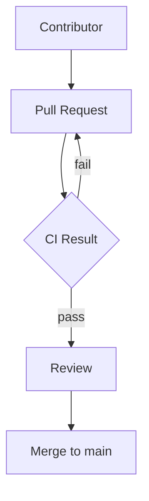

# Architecture Diagrams

This repository documents its architecture with diagrams kept under `docs/diagrams/`.

## Convention

- Diagrams are Mermaid. The source (`.mmd`) is committed alongside the rendered `.svg` so the diagram stays editable.
- Reference diagrams from `README.md` so new contributors find the current architecture view on arrival.
- Re-render the `.svg` in the same change as any source edit; never commit a rendered image without its source.
- Keep node labels to one to three words; landscape orientation (width greater than height).

## Example: Architecture View

## Status

- `architecture.mmd` / `architecture.svg`: webhook flow from GitHub event through the Cloudflare Worker (HMAC verification, ReplayGuard deduplication, IP allowlist, quota, aptu.yml gates) to `repository_dispatch`, reusable workflows, and the aptu CLI with the caller's AI key.
